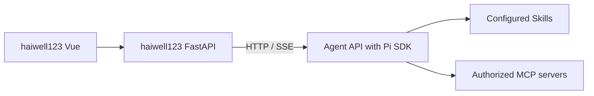

# Pilot

A session-isolated Agent API service built with Pi SDK, TypeScript, Node.js 26+, and embedded SQLite. It provides standard `SKILL.md` loading, administrator-configured MCP tools, persistent conversations, streamed responses, and run cancellation.

The `haiwell123` portal owns the user-facing chat interface. Its FastAPI backend calls this service over HTTP/SSE and supplies a trusted user identity. The Agent service owns conversations, model context, workspaces, Skills, and MCP connection lifecycle. RAG is an external capability maintained separately; this service contains no embedded retrieval, document-management API, SQL executor, or chat frontend.

## Quick Start

```bash
npm ci --ignore-scripts
npm run build
npm start
```

The service defaults to `127.0.0.1:8080` and `./data/agent`. `/health` works without model configuration. Protected APIs need `AGENT_API_TOKEN` and a trusted principal. Sending messages additionally requires an explicitly configured generation model; missing configuration returns 503 `model_not_configured` before message/run writes or MCP startup.

`npm start` reads an optional `.env` with Node's native `--env-file-if-exists`. Use `.env.example` as a reference. If a private `.env` already exists, preserve it and add the `AGENT_` settings; do not overwrite it.

Configure a service-only token and a real model, for example through an OpenAI-compatible local endpoint:

```text
AGENT_API_TOKEN=<a-generated-service-token>
AGENT_LLM_PROVIDER=custom
AGENT_LLM_BASE_URL=http://127.0.0.1:11434/v1
AGENT_LLM_MODEL=<an-installed-chat-model>
```

Replace the placeholders before starting. There is no default chat model or extractive fallback. Anthropic-compatible models use `AGENT_LLM_PROVIDER=anthropic`, an explicit model, and `AGENT_LLM_API_KEY`.

## Caller Identity and Isolation

Every `/api/v1` request requires:

```http
Authorization: Bearer <service-token>
X-User-Id: <trusted-user-or-anonymous-id>
X-Tenant-Id: <trusted-tenant-id>
```

`X-Tenant-Id` defaults to `default`. IDs accept 1–128 ASCII letters/digits and `.`, `_`, `:`, `@`, `+`, `-`, beginning with a letter or digit.

The bearer token authenticates a trusted application backend, not a browser user. The portal backend must authenticate its user or issue a server-side anonymous identity, overwrite these headers from that trusted context, and keep the service token out of the browser. Do not forward browser-supplied identity headers as authoritative. The Agent does not implement the portal's login system.

The recommended path is:



- Sessions and runs use opaque service-generated UUIDs. All operations check tenant/user ownership, including history, SSE replay, cancellation, and deletion. Missing and unowned resources both return 404.
- Each conversation has a separate Pi `AgentSession`, `SessionManager`, resource loader, settings, workspace, and MCP connections. Common immutable model configuration and administrator-published read-only Skills can be shared.
- Same-session reentry returns 409 `session_busy`; different conversations can run concurrently. Cancellation targets an exact run, so cancelling an old run cannot stop a newer one.
- Conversations survive runtime eviction and service restarts. A crash marks unfinished runs `interrupted`; it does not automatically replay tools. Loss of an established Pi context file returns a storage error rather than silently resetting the conversation.
- One Agent process owns a data directory at a time, enforced by a SQLite process lock. Scale separate instances with separate data directories; shared multi-process session storage is not part of this version.
- The service does not enable browser CORS or expose service credentials to the portal UI; use the portal backend proxy.

## HTTP Contract

Success: `{code:"ok",message:"ok",data:...}`. Error: `{code,message}` with an appropriate HTTP status. Responses include a generated `X-Request-Id`.

| Method | Path                                         | Behavior                                                                  |
| ------ | -------------------------------------------- | ------------------------------------------------------------------------- |
| GET    | `/health`                                    | Public basic health                                                       |
| GET    | `/api/v1/health/detail`                      | Model configuration and permitted capability counts                       |
| GET    | `/api/v1/skills`                             | Configured Skill names/descriptions, no internal paths                    |
| GET    | `/api/v1/mcp/servers`                        | MCP servers permitted for the caller; no URLs/commands/credentials        |
| POST   | `/api/v1/sessions`                           | Create an owned conversation, HTTP 201                                    |
| GET    | `/api/v1/sessions`                           | List this principal's conversations                                       |
| GET    | `/api/v1/sessions/{id}`                      | Metadata and `active_run_id`                                              |
| DELETE | `/api/v1/sessions/{id}`                      | Soft-delete an idle conversation                                          |
| GET    | `/api/v1/sessions/{id}/messages`             | Public user/assistant history; `limit` defaults to 100, clamped to 1–1000 |
| POST   | `/api/v1/sessions/{id}/messages`             | Start asynchronous execution, HTTP 202 with `{run}`                       |
| POST   | `/api/v1/sessions/{id}/messages/stream`      | Start execution and stream its events                                     |
| GET    | `/api/v1/sessions/{id}/runs/{run_id}`        | Run status, error code, and final `reply` when available                  |
| GET    | `/api/v1/sessions/{id}/runs/{run_id}/events` | Stream/replay owned events; optional `after` sequence                     |
| POST   | `/api/v1/sessions/{id}/runs/{run_id}/cancel` | Request cancellation of that exact run                                    |

Create a conversation with `{ "title": "Operations question" }`; title is optional, limited to 200 characters. Public metadata contains `id`, `title`, `created_at`, and `updated_at`. GET/list responses additionally contain `active_run_id`. Internal owner fields and Pi paths are not returned.

Message requests use:

```json
{
  "message": "Explain the available business tools",
  "skill": "service-help"
}
```

`message` is required and non-empty. `skill` is optional and selects a configured Skill explicitly; otherwise Pi can load relevant skills on demand. Unsupported request fields are rejected. Public history retains the original user text rather than replacing it with expanded Skill instructions.

The ordinary POST starts a run without holding a connection. Read its status/reply or attach to its events. Cancellation is asynchronous; its response may still say `running` while cancellation settles. Cancellation stops further execution and outstanding requests where supported, but cannot undo an external operation already performed.

Soft deletion removes the conversation from all normal API reads and closes its runtime. On-disk history is retained for operator-controlled retention/backup; it is not a physical erase operation. A running conversation must be cancelled and settle before deletion.

### SSE

Events are delivered as:

```text
id: <run-id>:<sequence>
event: token
data: {"type":"token","sequence":2,"session_id":"...","run_id":"...","content":"..."}
```

Event types:

- `run_started`: run/session IDs and initial status.
- `token`: incremental assistant text in `content`.
- `tool_start` / `tool_end`: tool name, call ID, and error flag; raw arguments/credentials are not exposed.
- `error`: stable code and sanitized message.
- `done`: terminal status (`completed`, `failed`, `cancelled`, or `interrupted`).

Events are persisted with monotonic per-run sequence numbers. GET events with `after=N` replays newer events and follows a running execution. Disconnecting the stream does not cancel the run; use the explicit cancellation API. Before headers are sent, validation/auth/model errors use normal HTTP JSON errors. After streaming starts, failures use `error` and `done` events.

The portal needs a streaming reader for chat. A JSON helper that awaits the full response body will not show incremental events. Configure reverse proxies to preserve streaming and disable buffering; the Agent sends `X-Accel-Buffering: no`.

Common errors: 400 `bad_request`/`principal_required`, 401 `unauthorized`, 404 `not_found`, 409 `session_busy`, 413 `payload_too_large`, 503 `auth_not_configured`/`model_not_configured`/`capacity_limited`, and run errors such as `mcp_unavailable`, `model_provider_error`, `run_timeout`, `run_limit_exceeded`, `session_storage_error`, and `service_restarted`.

## Skills

Place administrator-published skill packages under `AGENT_SKILLS_DIR` (default `./skills`):

```text
skills/
  service-help/
    SKILL.md
    references/
    assets/
```

Use the Agent Skills format with `name` and `description` frontmatter. Pi advertises metadata and reads the full Skill only when needed. The bundled `service-help` is a minimal example.

The read tool is confined to configured Skill resources and the current conversation's workspace, including realpath/symlink checks and a 1 MiB file limit. Common Skills are read-only application configuration. Shell, edit, write, arbitrary scripts, and SDK management commands are not exposed through chat. A Skill that needs executable code should call an administrator-provided MCP tool or an explicitly added confined tool; a `SKILL.md` instruction alone does not grant execution permissions.

No home-directory/parent-project Skills, extensions, credentials, models, or context files are automatically discovered. File-published Skill changes are activated by sending `SIGHUP`. Skill and support files are copied into immutable snapshots, so an active run keeps its original instructions even if an administrator edits the source. Disabled Skills and their support files are absent from the active read boundary. Personal mutable Skill storage and automatic learning are outside this version.

## MCP

Create a private `config/mcp.json` from `config/mcp.example.json`, or set `AGENT_MCP_CONFIG_PATH`. The file uses the familiar `mcpServers` shape plus an application-level `allow` policy. Missing `allow` denies all principals. `allow:"*"` explicitly permits every authenticated principal; arrays permit exact tenant/user pairs.

HTTP example:

```json
{
  "mcpServers": {
    "business": {
      "url": "https://example.invalid/mcp",
      "allow": [{ "tenant_id": "default", "user_id": "alice" }],
      "headers": {
        "Authorization": { "env": "BUSINESS_MCP_TOKEN", "prefix": "Bearer " },
        "X-User-Id": { "context": "user_id" },
        "X-Tenant-Id": { "context": "tenant_id" },
        "X-Session-Id": { "context": "session_id" }
      }
    }
  }
}
```

For local stdio servers use `command`, optional `args`, and `env` instead of `url` and `headers`. Prefer absolute server script paths because each connection runs in its conversation workspace:

```json
{
  "mcpServers": {
    "local": {
      "command": "node",
      "args": ["/path/to/mcp-server.js"],
      "allow": "*",
      "env": { "USER_ID": { "context": "user_id" } }
    }
  }
}
```

Values may be literal strings, safe `${ENV_NAME}` substitutions, `{env:"NAME",prefix:"..."}`, or `{context:"user_id"|"tenant_id"|"session_id",prefix:"..."}`. Command-based secret resolution is not supported. Stdio children do not inherit the service environment; they receive a minimal environment, a session-specific home/temp/work directory, and administrator-declared values.

Tools use Pi names such as `mcp__business__query`. The service selects direct tool exposure; optional `toolExposure` can set individual tools/patterns to `direct` or `hidden`. `enabled:false` disables a server, and `timeout` is its per-request timeout in seconds (default 30). Connections are independent per conversation and released on idle eviction/shutdown. Initial MCP readiness is bounded to 10 seconds; failure occurs before model prompting and can recover on a later run.

MCP servers and executable programs are administrator-trusted integrations with their own business authorization. Logical session/workspace confinement is not an OS sandbox for these programs. Authentication should be configured through headers/environment. Interactive OAuth browser login and `/mcp` administration are not exposed over the Agent API.

### Web Search

Web search is an Agent tool capability. The generation model decides when to search and summarizes returned material; the MCP service performs the network requests. A model that supports tool calling can use it without a model vendor's built-in browsing feature.

`config/mcp.web-search.example.json` connects to [Exa's hosted MCP](https://exa.ai/mcp) and exposes only `mcp__exa__web_search_exa` and `mcp__exa__web_fetch_exa`. The `web-search` Skill explains when to search, check original pages, and cite source links. Activate it explicitly with `"skill":"web-search"`, or let the model read it when its description matches the request.

For a standalone setup:

```bash
AGENT_MCP_CONFIG_PATH=./config/mcp.web-search.example.json npm start
```

If other MCP servers are already configured, merge the example's `exa` entry into the private configuration instead of replacing the file. `allow:"*"` permits all authenticated users; use exact tenant/user rules to restrict access. For Compose, set `AGENT_MCP_CONFIG_FILE=./config/mcp.web-search.example.json`, or mount your merged private file. Send `SIGHUP` after editing Skill/MCP files. Changing process environment variables requires restart.

Exa currently supports anonymous access with request limits. For higher limits, add `"headers":{"x-api-key":{"env":"EXA_API_KEY"}}` to the entry and set that variable privately; do not put credentials in URLs. Model API credentials are separate from search credentials. The empty `config/mcp.example.json` remains available for installations without external search.

Queries and requested URLs are sent to Exa. Send only necessary public terms/URLs; do not include credentials, internal documents, business results, or full conversations. Retrieved pages are external evidence, not instructions. Search does not perform business writes or deployment actions. The standard MCP readiness, per-conversation connection isolation, timeouts, cancellation, and tool budgets apply; unavailable MCP startup fails before model prompting.

## Capability Lifecycle and Reloading

Skills and MCP tools are managed purely through the local filesystem and configuration files:

- **Skills**: configured under `AGENT_SKILLS_DIR` (default `./skills`).
- **MCP Servers**: configured in `AGENT_MCP_CONFIG_PATH` (default `./config/mcp.json`).

Send `SIGHUP` to the Agent process (or run `systemctl reload agent`) to reload configuration without stopping the service or interrupting running sessions:

- Each run captures an immutable capability generation snapshot. In-flight runs continue using their initial snapshot until completion.
- Subsequent runs in any conversation automatically use the newly loaded generation.
- Retired capability snapshots and their cached runtimes are automatically cleaned up when active runs finish.
- If a reload encounters invalid configuration (syntax errors, escaped symlinks, or duplicate tools), the reload fails atomically and the service keeps running on the previous valid generation.

## Configuration

| Setting                                             | Default                                                                             |
| --------------------------------------------------- | ----------------------------------------------------------------------------------- |
| `AGENT_ADDR`                                        | `127.0.0.1:8080`                                                                    |
| `AGENT_DATA_DIR`                                    | `./data/agent`                                                                      |
| `AGENT_API_TOKEN`                                   | unset; protected APIs return 503 until configured                                   |
| `AGENT_SKILLS_DIR`                                  | `./skills`                                                                          |
| `AGENT_MCP_CONFIG_PATH`                             | `./config/mcp.json`; missing default file means no servers                          |
| `AGENT_LLM_PROVIDER`                                | `none`; aliases `custom`/`openai` → `openai-compatible`, `claude` → `anthropic`     |
| `AGENT_LLM_MODEL`                                   | empty; required for messages                                                        |
| `AGENT_LLM_BASE_URL`                                | OpenAI-compatible `/v1` endpoint; Anthropic API root                                |
| `AGENT_LLM_API_KEY`                                 | unset; Anthropic requires it; OpenAI-compatible requires it or an explicit endpoint |
| `AGENT_LLM_CONTEXT_WINDOW` / `AGENT_LLM_MAX_TOKENS` | `32768` / `4096`                                                                    |
| `AGENT_REQUEST_BODY_LIMIT_BYTES`                    | `2097152`                                                                           |
| `AGENT_MAX_MESSAGE_CHARS`                           | `20000`                                                                             |
| `AGENT_RUN_TIMEOUT_MS`                              | `120000`                                                                            |
| `AGENT_MAX_TURNS` / `AGENT_MAX_TOOL_CALLS`          | `10` / `30`                                                                         |
| `AGENT_MAX_ACTIVE_SESSIONS`                         | `50`                                                                                |
| `AGENT_IDLE_TIMEOUT_MS`                             | `900000`                                                                            |
| `AGENT_SYSTEM_PROMPT`                               | concise business-assistant instructions                                             |

Model credentials remain in memory and are not injected into prompts/tool schemas. Public errors are sanitized; normal logs contain lifecycle information rather than conversations or raw provider responses.

## Verification

```bash
npm run check
npm run build
npm run format:check
npm test
./scripts/smoke.sh
git diff --check
```

Tests use the real installed Pi SDK with local fake OpenAI-compatible model and HTTP/stdio MCP servers, not production systems. They cover Skills, prompting, MCP calls, identity/ownership, separate user/tenant/conversation context, confined reads and symlinks, concurrent streams, cancellation, deadlines/budgets, persisted recovery, missing-model behavior, removed legacy routes, atomic reload failure, and next-run capability changes in existing conversations.

## Deployment and Storage

```bash
docker compose up --build -d
```

The image uses Node.js 26 and runs as the non-root `node` user. Compose publishes 8080, persists `agent-data`, and mounts a read-only administrator MCP configuration (the empty example by default). Set `AGENT_MCP_CONFIG_FILE` to the host's private JSON file and configure `AGENT_` variables before deployment. `deploy/systemd/agent.service` is an installation example for `/opt/agent` and state under `/var/lib/agent`; provision its user/state directory and private environment file separately.

Back up the entire data directory after a clean stop: the SQLite ownership/message/run database and Pi JSONL context files form one logical state. Do not copy only the SQLite file while ignoring Pi contexts or active WAL files.

The portal frontend/backend integration is a separate change: add the Agent proxy and streaming UI in haiwell123 against this contract.
